# 🐋 🦈 Sitio Maestro del Tiburón Ballena

Actualización de mayo de 2025: ¡esta aplicación web ya está **EN LÍNEA**! Aún está en desarrollo, pero siéntete libre de empezar a explorarla!

——>  **[https://thewhaleshark.org](https://thewhaleshark.org)**  <—— 

*(el sitio también es accesible en [https://rhincodontypus.com](https://rhincodontypus.com))*

¿Preguntas? ¿Comentarios? Contáctanos en **info@thewhaleshark.org** o **info@rhincodontypus.com**

## Descripción

¡Sumérgete en el mundo de los gigantes amables con este **sitio maestro de datos del tiburón ballena**! 

Para este proyecto, `whale-shark-site`, mi objetivo es cerrar la brecha entre la investigación científica y la participación cotidiana reuniendo datos de tiburones, clima y océano de diversas fuentes, y canalizándolos en un solo sitio central que pueda atraer a usuarios de todos los ámbitos. 

## Tabla de Contenidos

- [Objetivos del Proyecto](#project-goals)
- [Resumen Técnico](#technical-overview)
- [Cómo Funciona](#how-it-works)
- [Características](#features)
- [Decisiones de Diseño](#design-choices)
- [Demostraciones en Video](#video-demos)
- [Imágenes de Ejemplo](#example-images)
- [Entrenamiento del Modelo de Visión por Computadora](#cv-model-training)
- [Agradecimientos](#acknowledgements)

## Objetivos del Proyecto

Aunque esta plataforma es inherentemente educativa, quiero que también sea **accesible y emocionante**. Debería reflejar la sensación que experimentas al entrar a un museo realmente interesante o a una biblioteca particularmente impresionante. Este sitio maestro de datos del tiburón ballena es una especie de campo de juegos. Está diseñado para ser **descubierto y explorado**.

Este es un **trabajo en progreso**, pero puedo asegurarles que estoy rebosante de ideas y planes. Un proyecto de esta envergadura es una gran tarea con muchas piezas móviles, así que por favor, esperen un poco mientras sigo trabajando en él. 🚀 

Mientras tanto, siéntete libre de explorar la base de código y/o contactarme con cualquier pregunta. 

## Resumen Técnico

### Fuentes de Datos

- **GBIF**: Datos de biodiversidad (registros de tiburones ballena)

- **NASA**: Datos climáticos y de la Tierra

- **Copernicus**: Datos oceánicos y marinos

### Stack Tecnológico

- **Python**: APIs + tuberías de datos (pipelines)

- **Vite + React**: Aplicación web

- **JavaScript + TypeScript**: Utilidades web subyacentes

- **Three.js (+ WebGL)**: Gráficos web 3D

- **P5.js + D3.js**: Visualizaciones interactivas para web y datos

- **PyTorch**: Entrenamiento de modelos de visión por computadora

- **Pandas + NumPy**: Tuberías de datos + visión por computadora

- **LLMs (Mistral, Gemma, OpenAI GPT)**: IA generativa (nombres de tiburones + dibujos animados)

### Visión por Computadora

- **YOLOv8**: Modelo de Ultralytics para detección de objetos, comenzando con COCO y ajustando el modelo

- **MiewID-msv3**: Modelo de Hugging Face para identificar organismos específicos (¿de qué tiburón se trata?)

- ¡Visita la subcarpeta [computer-vision](./computer-vision/README.md) para obtener detalles adicionales y agradecimientos!

## Cómo Funciona

### Tuberías de datos (ETL)

1. Datos obtenidos desde puntos finales de API

2. Datos limpiados, preparados, agregados y analizados

3. Datos almacenados y llamados para uso web

### Sitio web (aplicación web)

1. Páginas dedicadas a diferentes audiencias

    - **Ciencia e investigación** (datos + detalles)

    - **Diversión y juego** (interacción + conexión)

2. Información de las tuberías de datos integrada en las páginas web

3. Librerías de JavaScript mejoran la presentación del contenido para involucrar al usuario

## Características

- **🌍 Modelos realistas de la Tierra**: Globos de Three.js diseñados para el descubrimiento y la exploración de datos.
- **🛰️ Seguimiento satelital por etiqueta**: Mapeo de dónde han estado los tiburones y hacia dónde se dirigen.

- **🦈 Tarjetas individuales de tiburones**: Detalles personales de diversos tiburones ballena en todo el mundo.
- **🤿 Historias personales de buzos**: Registros y aprendizajes de buzos que los han encontrado.

- **💻 Coincidencia por visión por computadora**: Integración de un excelente modelo de código abierto de Hugging Face.
- **🎨 Creación Build-A-Shark con LLM**: Personalización única de un dibujo animado de tiburón ballena usando IA generativa.

- **📊 Tendencias históricas de datos**: Perspectivas holísticas sobre los tiburones (+ factores relacionados) a lo largo del tiempo.
- **📸 Medios reales y visuales limpios**: Imágenes, videos y numerosas visualizaciones bien pensadas.

- **📐 Entorno de animación dinámica**: Campo de juego creativo para experimentar con modelos de nadadores.
- **🧪 Laboratorio práctico de geomapeo**: Oportunidad de guardar tiburones ballena favoritos para obtener información personalizada.

## Decisiones de Diseño

- **Separación modular**: Aislamiento cuidadoso de las tuberías de datos y los procesos web para mantener la claridad.

- **Componentes reutilizables**: Características construidas de forma iterativa y con máxima flexibilidad para su reutilización posterior.

- **Escalabilidad funcional**: Almacenamiento de datos eficiente y organización web para una expansión a largo plazo.

- **Educación lúdica**: Mucho por aprender, pero con la exploración y la participación como objetivos principales.

- **Segmentación de contenido**: División lógica de zonas web para una experiencia de usuario cohesiva.

## Demostraciones en Video

🌊 Animación de Nado del Modelo 3D   |   🌍 Narración con Globo de la Página de Seguimiento
:-------------------------------:|:-------------------------------:
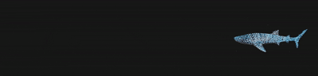  |  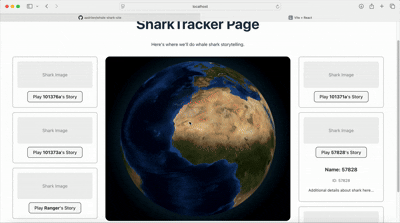

🌌 Bienvenida a la Página de Inicio del Tiburón Ballena   |   🪐 Tiburón 3D Pulsante
:-------------------------------:|:-------------------------------:
   |  

## Imágenes de Ejemplo

📝 Detalles del Tiburón   |   🪪 Tarjeta Individual de Tiburón   |   📱 Cuadrícula de Historias de Tiburones
:-------------------------:|:-------------------------:|:-------------------------:
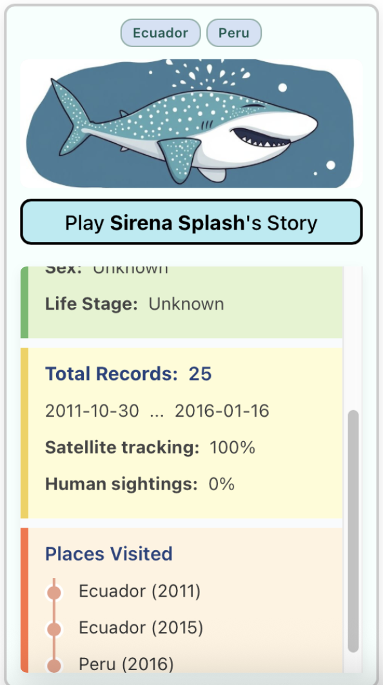  |  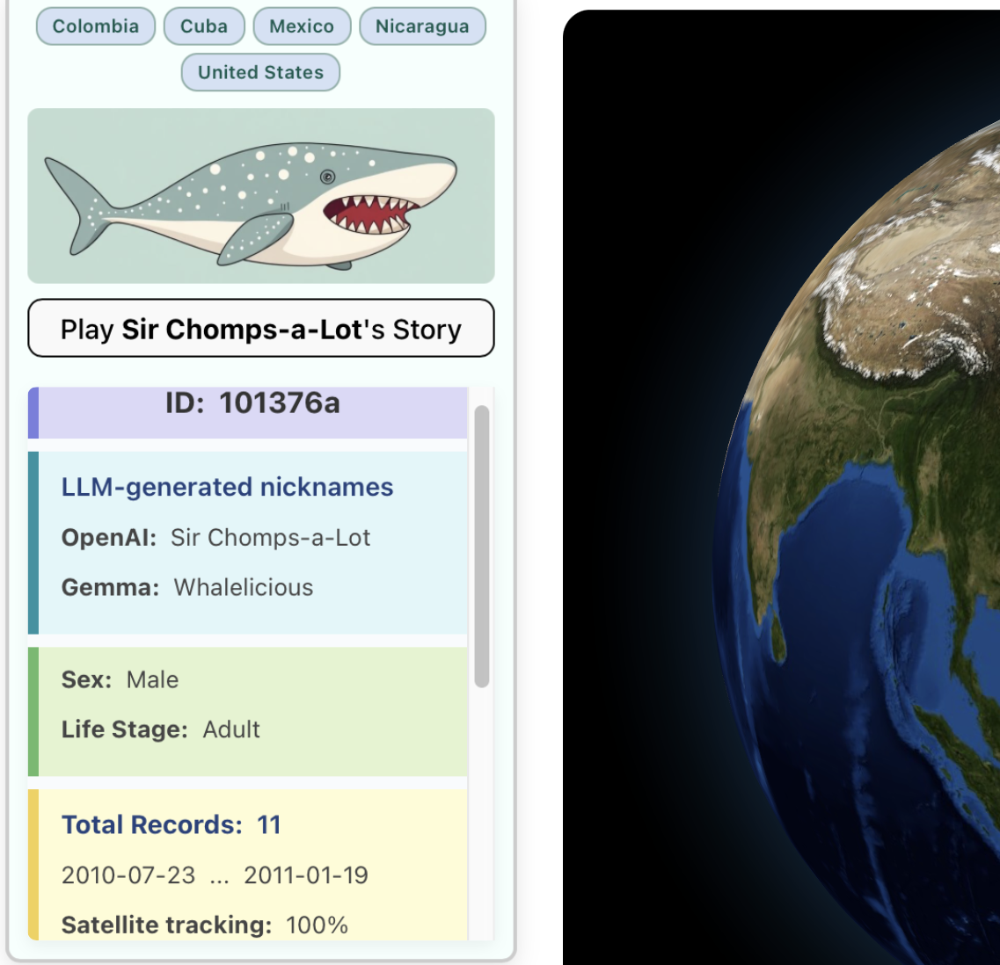  |  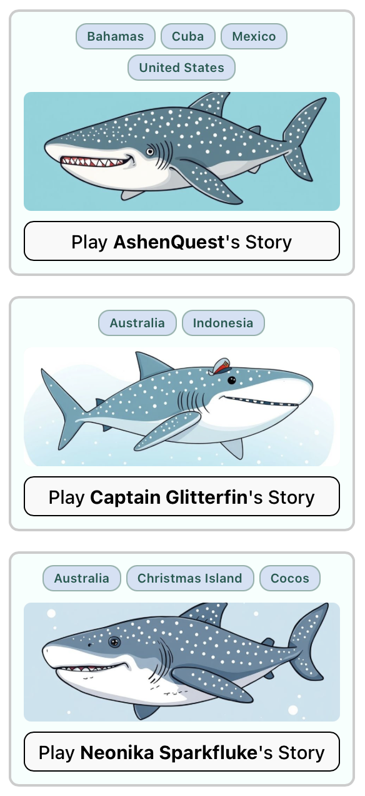

📖 Historia de Tiburón en Progreso   |   📍 Vista de Globo de Geomapeo
:-------------------------:|:-------------------------:
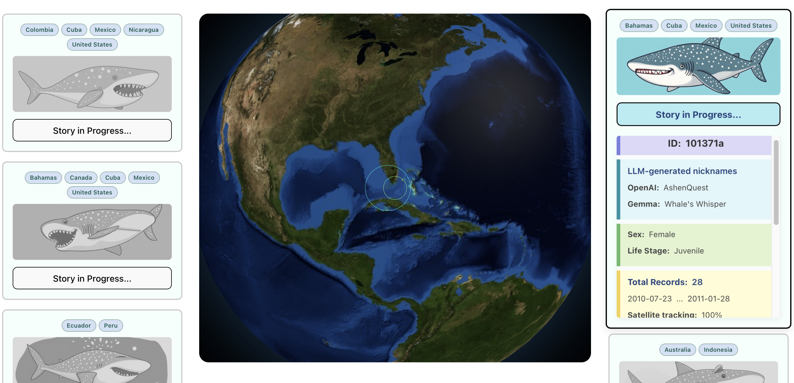  |  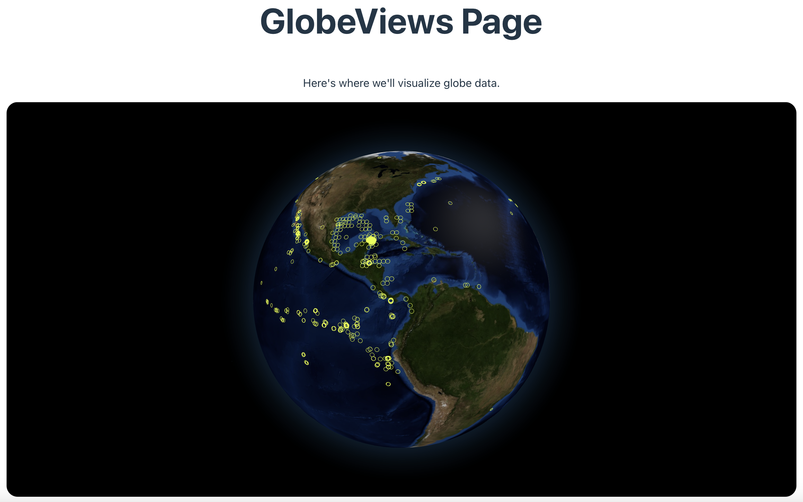

⭐️ Tiburones Guardados en el Cuaderno de Bitácora   |   💾 Bitácora Auxiliar Compacta
:-------------------------:|:-------------------------:
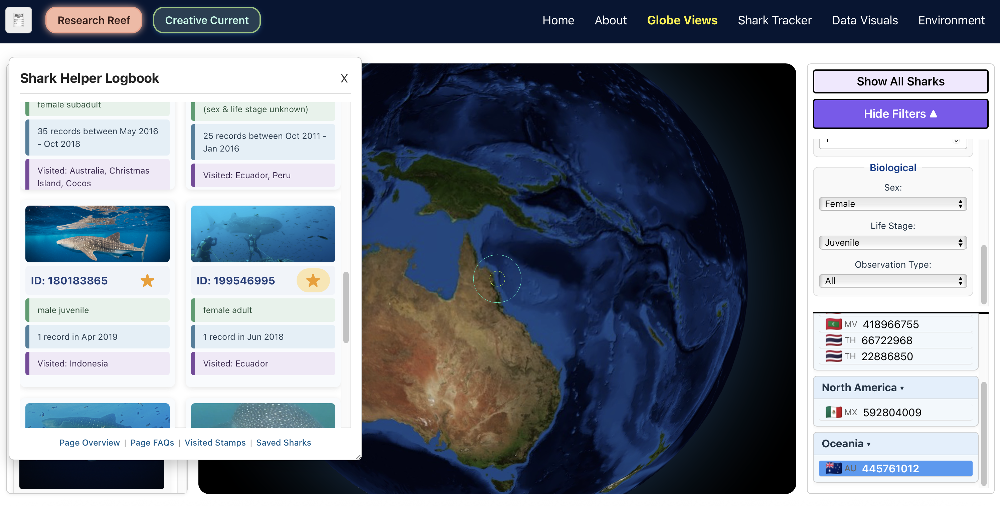  |  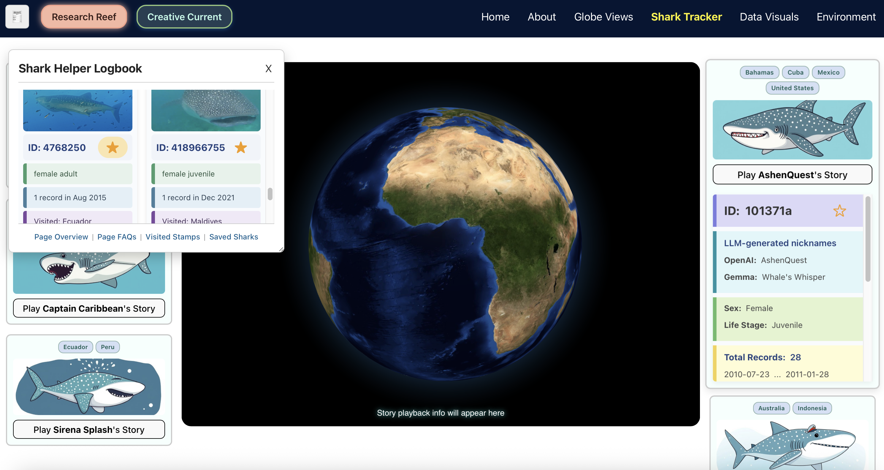

🎢 Creación de Ruta de Animación 
:-------------------------:
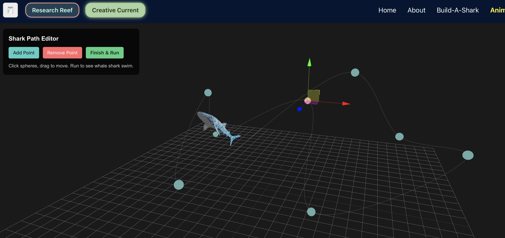 

<table>
    <tr>
        <td colspan="3" style="text-align: center;">
            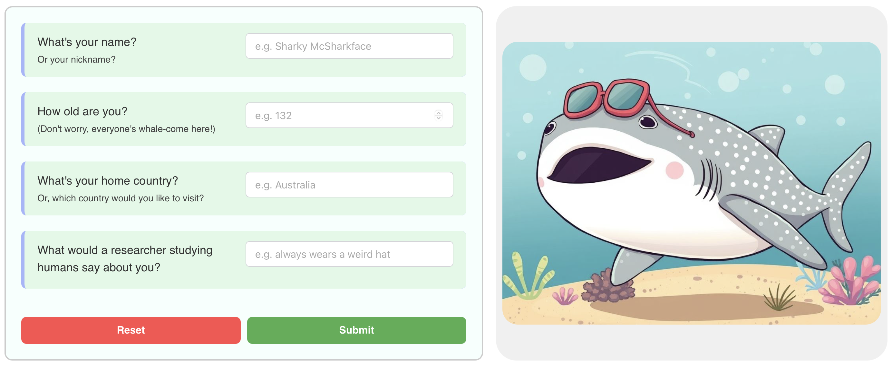
            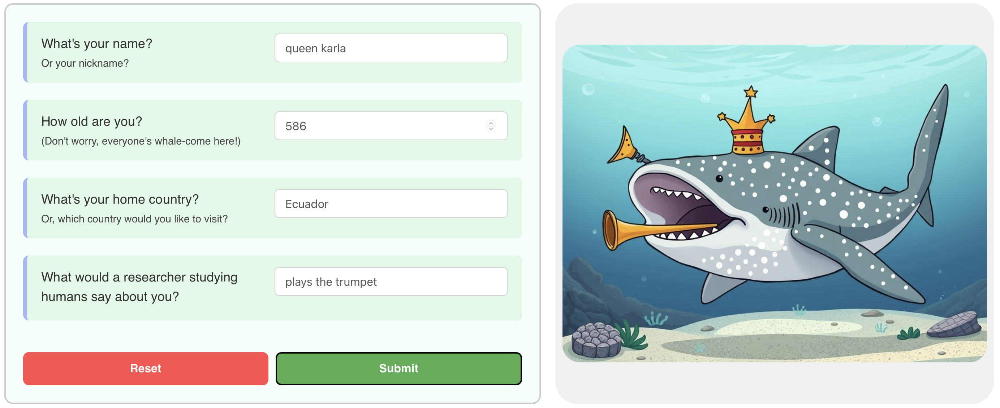
        </td>
    </tr>
    <tr>
        <td>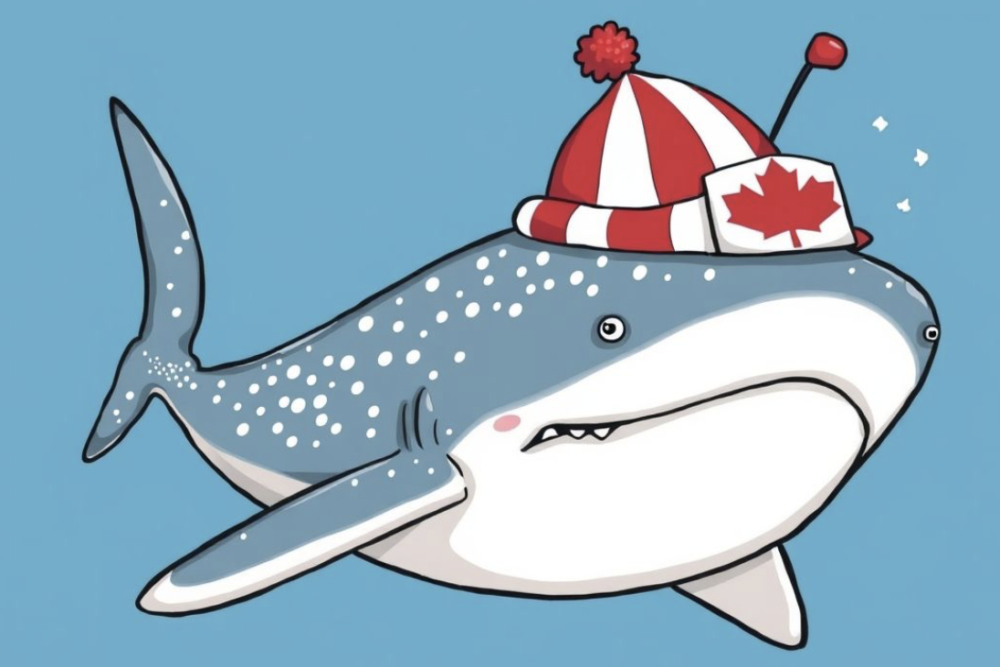</td>
        <td>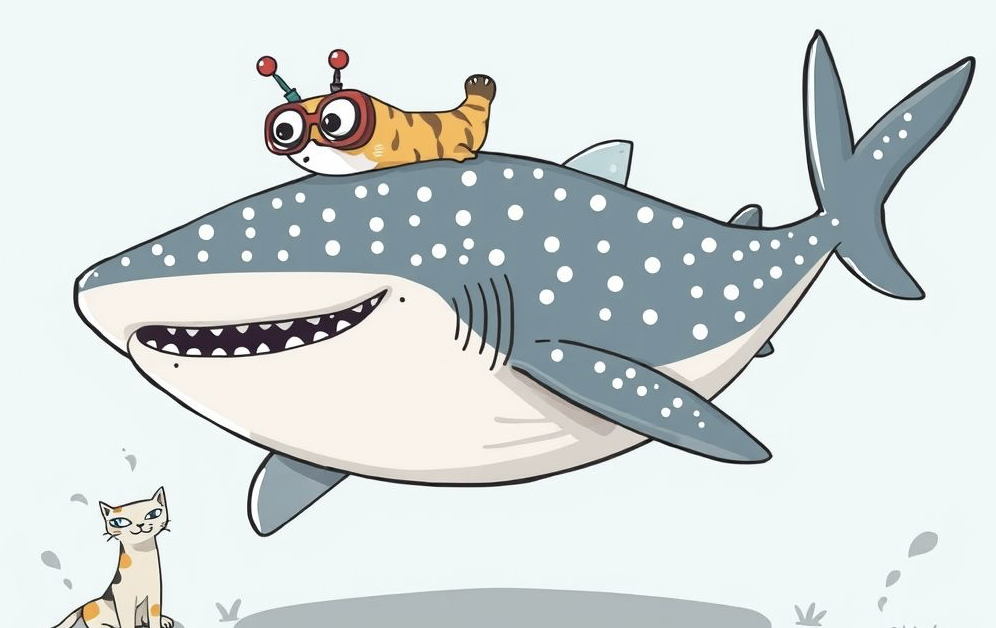</td>
        <td>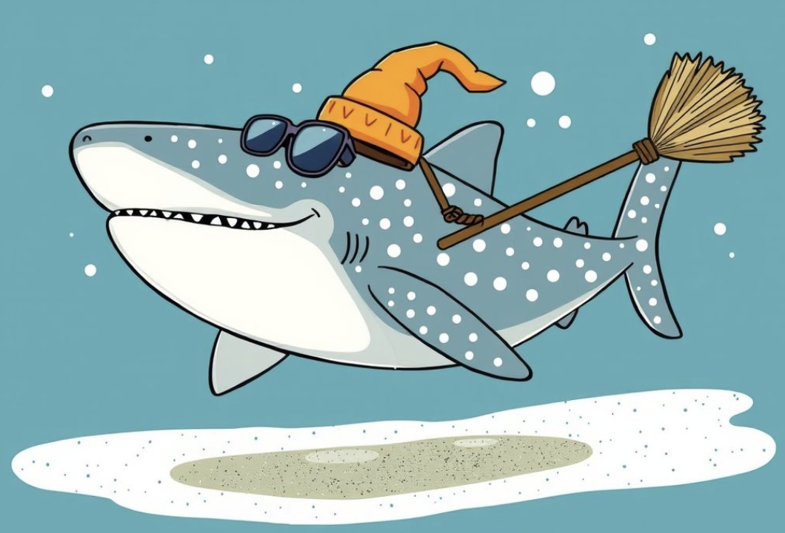</td>
    </tr>
</table>

## Entrenamiento del Modelo de Visión por Computadora

🧩 Modelo YOLOv8 (Línea Base COCO)   |   🧠 Modelo YOLOv8 (Ejecuciones de Entrenamiento)
:-------------------------------:|:-------------------------------:
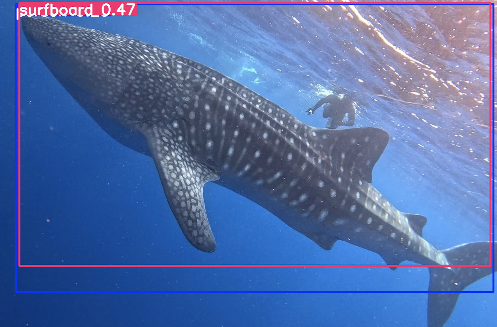  |  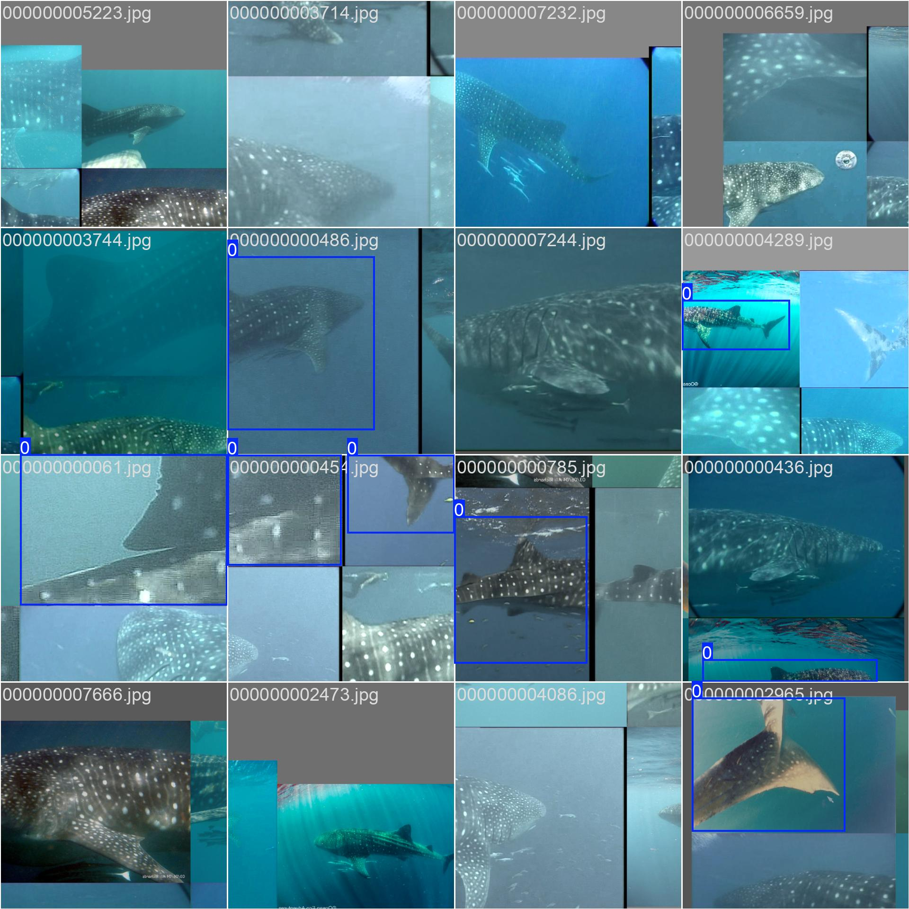

## Agradecimientos

### Personas

Un inmenso agradecimiento a la maravillosa comunidad de constructores, creadores y programadores de [the Recurse Center](https://www.recurse.com)!. Gran parte de este proyecto se ha desarrollado durante mi estancia en RC, y me inspiro constantemente con la energía y la pasión de quienes me rodean.

En particular, gracias a [Anjana Vakil](https://github.com/vakila) y [Adam Kelly](https://github.com/cthulahoops) de RC por tomarse el tiempo de hacer una revisión de código en las características de visualización de datos y la bitácora auxiliar! 

Gracias a Anastasia del equipo de soporte de [Wild Me](https://www.wildme.org) por charlar conmigo sobre [Sharkbook](https://www.sharkbook.ai), y por compartir recursos de código abierto como el software de [Análisis de Imágenes](https://github.com/WildMeOrg/wildbook-ia) de Wildbook!

Gracias a Leïla del equipo de soporte de [Copernicus Marine](https://marine.copernicus.eu) por ayudarme a solucionar problemas relacionados con las capacidades del [MyOcean Pro Viewer](https://marine.copernicus.eu/access-data/ocean-visualisation-tools) en relación con las importaciones de datos de terceros!

### APIs y Datos

Utilicé datos de biodiversidad de [GBIF](https://www.gbif.org) para acceder a registros de tiburones ballena.

Utilicé el visor incrustado de MyOcean Pro de [Copernicus Marine](https://marine.copernicus.eu) para visualizar datos oceánicos.

Utilicé la API de [Pollinations.AI](https://pollinations.ai) para acceder a la generación de texto e imagen de OpenAI.

### Bibliotecas y Módulos

Gracias a Sean Bradley, cuyo módulo de código abierto [JEasings](https://github.com/Sean-Bradley/JEasings), un motor de animación en JavaScript, me permite controlar los movimientos en el globo de Three.js para el "modo de narración".

### Estilo y Controles

Gracias a Jamie Wilson, cuyo [cambiador de temas](https://codepen.io/jamiewilsonict/pen/LYKGjdb) de código abierto sirvió de inspiración para mi propia adaptación de un botón de alternancia entre modo claro y oscuro!

### Créditos del Modelo 3D

["Whale Shark Fantasy"](https://skfb.ly/6ysSQ) de Alenzo está licenciado bajo [Creative Commons Atribución](http://creativecommons.org/licenses/by/4.0/).
